  

  

---

### `> sobre mí`

- 🛠️ Desarrollo aplicaciones web con **Django**, de la base de datos al servidor.
- 🚀 Despliego y mantengo mis apps en servidores **Linux** y **Render**.
- 📈 También trabajo en **estrategia de negocio y marketing**: publicidad y entrada a mercados.
- 📍 México

### `> proyectos`

| Proyecto | Qué es | Stack |
|---|---|---|
| **Sistema de gestión — construcción** | Administración interna y checador para una empresa de excavación y concreto | Django · Render |
| **TaEx** | Plataforma web educativa | Django · MongoDB |

### `> stack`

  
  
  
  
  
  
  
  

### `> actividad`

  
  

  

---

  

